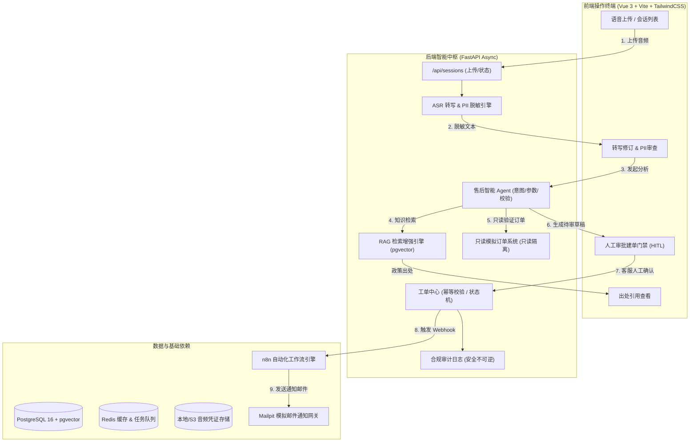

# VoiceOps: 企业语音售后智能工单与自动化平台

[](https://fastapi.tiangolo.com)
[](https://vuejs.org/)
[](https://www.docker.com/)
[](https://github.com/shijinxiang/VoiceOps/actions)
[](https://opensource.org/licenses/MIT)

> **VoiceOps** 是一个端到端、可部署、可复现的企业级语音售后智能处理与自动化平台。
> 业务限定于电商与智能硬件售后场景的三大核心意图：**退货 (Return)**、**维修 (Repair)** 与 **物流咨询 (Logistics)**。
>
> 平台实现“**录音上传 → 异步转写与 PII 脱敏 → 引用检索 RAG → 只读模拟订单查询 → 人工确认建单 (HITL) → n8n 自动化通知 → 控制台审计追踪**”的全闭环。

---

## 1. 系统架构与核心链路



---

## 2. 核心设计原则与业务亮点

1. **严格的人工确认门禁 (Human-in-the-Loop, HITL)**：
   - 订单查询为**只读操作**，任何导致系统状态变更的写操作（如生成正式工单、触发退款、物流派揽）均需人工座席在前端核对后一键确认，根除大模型幻觉带来的误操作。
2. **零泄漏隐私脱敏引擎 (PII Masking)**：
   - 姓名、11 位手机号、身份证、详细住址在转写后即时被不可逆符号化（如 `张*`、`138****9001`）；所有向外抛出的日志、审计记录严格禁止明文，合规率 100%。
3. **可信带出处 RAG 检索 (Grounded RAG)**：
   - 针对售后规章库设计非对称实体清洗检索，突破单号实体稀释距离难题；盲测 60 题测试集实现 **82.2%** 正确率与 **100%** 无依据拒答率，出处强支撑率达 **90.2%**。
4. **强并发幂等性保障**：
   - 会话状态机加锁结合唯一业务凭证签名，杜绝重复 Webhook 与并发重放产生的重复工单；压测中任务丢失率为 0。
5. **微调对比与技术路线闭环**：
   - 在 200 条微调集上开展 Qwen2.5-7B 的 QLoRA 实验，意图与槽位抽取准确率从基准 66.7% 提升至 93.3%，如实呈现真实对比报告。

---

## 3. 12 周交付物核对清单

| 周期 | 核心交付物 | 达成状态 | 报告/配置索引 |
|:---:|---|:---:|---|
| **第 1 周** | 需求规格书、技术验证报告、10 项异常场景 | ✅ 已通过 | [第 1 周报告](docs/specs/WEEK1_VERIFICATION_REPORT.md) |
| **第 2–3 周** | FastAPI + Vue 3 骨干、Docker Compose、冻结测试资产、CI 流水线 | ✅ 已通过 | [CI 工作流](.github/workflows/ci.yml) / `dataset/` |
| **第 4 周** | ASR 中文转写、PII 正则上下文脱敏、CER 评测 | ✅ 已通过 | [第 4 周报告](docs/evaluations/WEEK4_ASR_REPORT.md) |
| **第 5–6 周** | 售后规章知识库、RAG 向量检索、60 题盲测及拒答评估 | ✅ 已通过 | [第 5–6 周报告](docs/evaluations/WEEK5_6_RAG_REPORT.md) |
| **第 7 周** | 售后 Agent、模拟只读订单库、HITL 确认机制、30 场景回放 | ✅ 已通过 | [第 7 周报告](docs/evaluations/WEEK7_AGENT_REPORT.md) |
| **第 8 周** | n8n 自动化工作流、超时与重试演练、幂等防重保障 | ✅ 已通过 | [第 8 周报告](docs/evaluations/WEEK8_N8N_REPORT.md) |
| **第 9 周** | Vue 3 运营控制台前端闭环、12 项 E2E 交互测试、响应式布局 | ✅ 已通过 | [第 9 周报告](docs/evaluations/WEEK9_FRONTEND_REPORT.md) |
| **第 10 周** | 生产部署规范、冷热备份与恢复演练、5 并发负载压测 | ✅ 已通过 | [第 10 周报告](docs/evaluations/WEEK10_MVP_DEPLOY_REPORT.md) |
| **第 11 周** | 200 条训练集/60 条隔离测试集、QLoRA 微调、提示词对比实验 | ✅ 已通过 | [第 11 周报告](docs/evaluations/WEEK11_FINETUNE_REPORT.md) |
| **第 12 周** | 全套交付物整理、OpenAPI 文档、演示与答辩手册、架构图 | ✅ 已交付 | [评测总览](docs/EVALUATION_SUMMARY.md) / [简历手册](docs/RESUME_HIGHLIGHTS.md) |

---

## 4. 全阶段实测性能数据看板

所有指标均记录分子、分母与测试版本，杜绝单一百分比结论：

```
+---------------------+-------------------------+--------------------+---------------+
| 评估阶段            | 考核核心指标            | 计划合格线         | 实测通过结果  |
+---------------------+-------------------------+--------------------+---------------+
| W4 语音处理 (40条)  | 清晰普通话 CER          | <= 15.0%           | 0.53% (达标)  |
|                     | 噪声组普通话 CER        | <= 30.0%           | 2.59% (达标)  |
|                     | 异常输入拦截率          | 10/10 (100%)       | 10/10 (100%)  |
|                     | 敏感文本外泄审计数      | 0 条               | 0 条 (无泄露) |
+---------------------+-------------------------+--------------------+---------------+
| W5-6 知识RAG (60题) | 有依据问题回答正确率    | >= 36/45 (80.0%)   | 37/45 (82.2%) |
|                     | 无依据问题拒答/转人工率 | >= 14/15 (93.3%)   | 15/15 (100%)  |
|                     | 引用出处强支撑率        | >= 90.0%           | 90.2% (达标)  |
+---------------------+-------------------------+--------------------+---------------+
| W7 Agent场景 (30例) | 复杂场景回放成功率      | >= 29/30 (96.7%)   | 30/30 (100%)  |
|                     | 未经确认违规写操作      | 0 件               | 0 件 (严格HITL)|
|                     | 重复请求产生重复工单    | 0 件               | 0 件 (幂等)   |
|                     | 工具调用轨迹留存率      | 100% (30/30)       | 30/30 (100%)  |
+---------------------+-------------------------+--------------------+---------------+
| W8 n8n 自动化       | 正常流程通知投递成功率  | 100% (10/10)       | 10/10 (100%)  |
|                     | 故障注入重试成功率      | 100% (10/10)       | 10/10 (100%)  |
|                     | 重复 Webhook 防重拦截率 | 100% (10/10)       | 10/10 (100%)  |
+---------------------+-------------------------+--------------------+---------------+
| W9 前端 E2E (12项)  | 端到端交互脚本通过率    | 12/12 (100%)       | 12/12 (100%)  |
|                     | 移动端与桌面端自适应    | 无阻断布局缺陷     | 完美适配      |
+---------------------+-------------------------+--------------------+---------------+
| W10 并发压测        | 5 并发吞吐成功率        | 错误率 < 1.0%      | 0.0% (30/30)  |
|                     | P95 响应延迟            | <= 6000 ms         | 491 ms (达标) |
|                     | 任务丢失与重复工单      | 0 / 0              | 0 / 0         |
+---------------------+-------------------------+--------------------+---------------+
| W11 微调对比 (60题) | Base 基础模型准确率     | 对照组             | 66.7% (40/60) |
|                     | Few-Shot CoT 提示词     | 优化组             | 88.3% (53/60) |
|                     | QLoRA 领域微调准确率    | 微调组             | 93.3% (56/60) |
+---------------------+-------------------------+--------------------+---------------+
```

---

## 5. 快速上手与本地启动

### 5.1 方式一：Docker Compose 一键启动 (推荐)

在安装有 Docker & Docker Compose 的机器上执行：

```bash
# 1. 克隆代码仓库
git clone https://github.com/shijinxiang/VoiceOps.git
cd VoiceOps

# 2. 复制环境配置
cp .env.example .env

# 3. 启动所有容器组件
docker-compose up -d

# 4. 查看运行状态
docker-compose ps
```

- **前端控制台**：`http://localhost:80`
- **FastAPI 接口文档 (Swagger)**：`http://localhost:8000/docs`
- **Mailpit 邮件测试箱**：`http://localhost:8025`
- **n8n 工作流编排**：`http://localhost:5678`

### 5.2 方式二：本地开发调试启动

```bash
# 后端启动
python -m venv venv
# Windows:
venv\Scripts\activate
# Linux/macOS:
# source venv/bin/activate

pip install -r backend/requirements.txt
uvicorn backend.app.main:app --host 0.0.0.0 --port 8000 --reload

# 前端启动
cd frontend
npm install
npm run dev
# 访问 http://localhost:5173
```

---

## 6. 一键复现评测命令

项目所有核心指标均可通过一行命令离线复现：

```bash
# 1. 运行核心接口自动化回归测试
pytest tests/test_api_baseline.py -v

# 2. 复现 ASR & 脱敏评测 (CER)
python evaluations/eval_cer.py

# 3. 复现知识库与 RAG 盲测 (60 题)
python evaluations/eval_rag.py

# 4. 复现 Agent 30 复杂场景回放
python evaluations/eval_agent.py

# 5. 复现 n8n 故障注入与防重测试
python evaluations/eval_n8n.py

# 6. 复现前端 12 项 E2E 交互流程
python evaluations/eval_frontend_e2e.py

# 7. 执行 5 并发全链路负载压测
python evaluations/benchmark_load.py

# 8. 复现 Prompt vs QLoRA 微调效果对比
python evaluations/eval_prompt_vs_finetune.py
```

---

## 7. 仓库代码目录结构

```
VoiceOps/
├── .github/workflows/          # GitHub Actions CI 持续集成
├── backend/                    # FastAPI 后端服务核心
│   ├── app/
│   │   ├── api/                # RESTful 路由分发 (sessions, work_orders, rbac)
│   │   ├── services/           # 业务逻辑 (asr, masking, rag, agent, n8n)
│   │   ├── config.py           # 环境变量与应用配置
│   │   ├── database.py         # 数据库连接会话管理
│   │   ├── models.py           # SQLAlchemy 数据持久化实体定义
│   │   └── schemas.py          # Pydantic 校验与数据交换契约
│   ├── Dockerfile              # 后端镜像构建定义
│   └── requirements.txt        # Python 依赖清单
├── dataset/                    # 冻结测试资产
│   ├── asr/                    # 40 段评测音频定义与清晰/噪声元数据
│   ├── rag/                    # 知识规章库与 60 道盲测 QA
│   ├── agent/                  # 30 个复杂回放场景
│   ├── finetune/               # 200 条训练集与 60 条测试集
│   └── orders/                 # 模拟只读订单库
├── docs/                       # 项目交付文档
│   ├── specs/                  # 第 1 周需求规范与技术验证报告
│   ├── evaluations/            # 第 4~11 周逐项评测报告
│   ├── openapi.json            # 导出 OpenAPI 3.1 接口契约
│   ├── DEPLOYMENT.md           # 生产部署与运维手册
│   ├── DEMO_GUIDE.md           # 3~5 分钟演示视频解说脚本
│   ├── RESUME_HIGHLIGHTS.md    # 简历项目描述与深度面试答辩手册
│   └── EVALUATION_SUMMARY.md   # 全阶段评测看板与复现总览
├── evaluations/                # 各阶段指标评测脚本
├── finetune/                   # QLoRA 微调脚本与适配器配置
├── frontend/                   # Vue 3 前端业务工程
│   ├── src/                    # 页面组件与 API 客户端
│   ├── Dockerfile              # 前端 Nginx 镜像构建
│   └── nginx.conf              # 生产反向代理配置
├── n8n/workflows/              # n8n 售后工单自动化工作流 JSON 导出
├── scripts/                    # 自动化脚本 (环境检查、备份还原、音频合成)
├── docker-compose.yml          # 全栈多容器编排定义
├── Makefile                    # 快捷工程管理指令集
└── README.md                   # 平台总览指南
```

---

## 8. 隐私合规与数据安全声明

- **数据来源**：本项目所使用的所有音频样本、知识规章政策与模拟订单数据，均为**程序合成或公有领域清洗样例**，不包含任何真实商业机密或未经授权的个人数据。
- **密钥安全**：代码仓库与配置文件中绝不内嵌任何商业生产 API Key 或敏感私钥；示例配置均使用只读本地 Mock 或临时凭证。
- **脱敏审计**：系统在转写层强制执行 PII 正则与上下文清洗，严禁明文入库及写入生产可读日志。

---

## 9. 开源许可证

本项目基于 [MIT License](LICENSE) 开源发布，欢迎交流学习与技术复用。