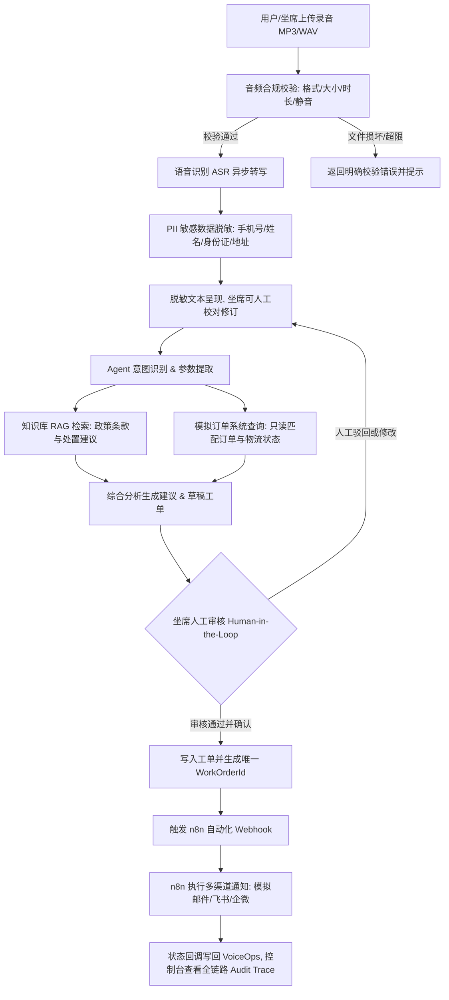

# VoiceOps 需求规范与技术验证方案 (Week 1)

## 1. 项目定位与业务边界

VoiceOps 是一套面向企业语音售后场景的智能工单与决策支持系统。系统针对客户来电或留存的短语音录音进行端到端自动化处理与辅助人工审核决策。

### 1.1 业务范围定义（首版 MVP 限定 3 类核心业务意图）
1. **退货申请 (Return)**
   - 包含：7天无理由退货、质量问题退换货、包装破损退换、赠品退回规则。
   - 判定标准：商品签收时间（≤7天 / >7天）、商品完好度、退货原因及凭证。
2. **维修保修 (Repair)**
   - 包含：商品硬件故障申报、保修期查询（1年质保/过保判定）、寄修申请、人为损坏与非人为损坏政策判定。
   - 判定标准：商品序列号/订单号、购买时间（≤365天 / >365天）、故障描述。
3. **物流与配送咨询 (Logistics Inquiry)**
   - 包含：快递轨迹查询、派送延误催单、快递员电话查询、修改配送地址/改约派送时间。
   - 判定标准：物流运单号、当前派送状态、时效承诺（如24/48小时）。
4. **超纲业务与通用咨询 (Out of Scope)**
   - 投诉举报、催促发票、未授权跨品类问题等，系统识别后进行免责提醒并转人工客服，避免 Agent 越权操作。

---

## 2. 核心用户体验流程 (User Journey & Flowchart)

---

## 3. 数据模型设计 (PostgreSQL 实体关系定义)

### 3.1 核心实体设计

1. **`sessions` (售后会话表)**
   - `id`: UUID, 主键
   - `session_code`: VARCHAR(32), 业务编号 (例如 `SESS-20261005-001`)
   - `customer_name_masked`: VARCHAR(64), 脱敏客户姓名
   - `customer_phone_masked`: VARCHAR(32), 脱敏手机号
   - `channel`: VARCHAR(20), 接入渠道 (如 `web_upload`, `call_center`)
   - `status`: VARCHAR(20), 会话状态 (`created`, `processing`, `pending_confirmation`, `completed`, `failed`)
   - `created_at`, `updated_at`: TIMESTAMP

2. **`audio_files` (音频文件表)**
   - `id`: UUID, 主键
   - `session_id`: UUID, 外键关联 `sessions.id`
   - `original_filename`: VARCHAR(255), 原文件名
   - `storage_path`: VARCHAR(512), 本地/MinIO 存储路径
   - `file_size_bytes`: BIGINT, 文件字节大小
   - `duration_seconds`: FLOAT, 音频时长（秒）
   - `mime_type`: VARCHAR(64), 如 `audio/wav`, `audio/mpeg`
   - `audio_hash`: VARCHAR(64), SHA256 用于去重校验
   - `created_at`: TIMESTAMP

3. **`transcriptions` (转写与脱敏记录表)**
   - `id`: UUID, 主键
   - `session_id`: UUID, 外键
   - `raw_text`: TEXT, 原始未脱敏转写文本（加密或内部隔离受控）
   - `masked_text`: TEXT, 脱敏后文本（对外日志与 LLM 上下文统一使用）
   - `is_manually_edited`: BOOLEAN, 是否经过人工修正
   - `edited_text`: TEXT, 人工修正后的文本
   - `status`: VARCHAR(20), `pending`, `running`, `succeeded`, `failed`
   - `asr_model`: VARCHAR(64), 使用的 ASR 模型标识
   - `processing_time_ms`: INTEGER, 转写耗时毫秒
   - `cer_score`: FLOAT, 评测比对 CER 分数 (评测时记录)
   - `created_at`, `updated_at`: TIMESTAMP

4. **`knowledge_chunks` (知识库片段与向量表)**
   - `id`: UUID, 主键
   - `doc_title`: VARCHAR(255), 文档标题（如《2026年企业售后退换货服务规范》）
   - `category`: VARCHAR(50), 分类 (`return`, `repair`, `logistics`, `general`)
   - `chunk_index`: INTEGER, 切片序号
   - `content`: TEXT, 文本内容
   - `policy_code`: VARCHAR(50), 政策条款编号（如 `RET-P-001`）
   - `embedding`: VECTOR(1536) 或 VECTOR(768), pgvector 向量嵌入
   - `created_at`: TIMESTAMP

5. **`orders` (模拟业务订单表 - 只读仿真数据)**
   - `order_id`: VARCHAR(32), 主键 (如 `ORD-20261001-8848`)
   - `customer_name`: VARCHAR(64), 客户真实姓名
   - `customer_phone`: VARCHAR(32), 客户电话
   - `product_name`: VARCHAR(128), 购买商品 (如 "UltraVoice Pro 降噪耳机")
   - `order_amount`: NUMERIC(10, 2), 订单金额
   - `purchase_date`: TIMESTAMP, 下单购买时间
   - `delivery_date`: TIMESTAMP, 物流签收时间
   - `shipping_company`: VARCHAR(64), 快递公司 (如 "顺丰速运")
   - `tracking_number`: VARCHAR(64), 运单号
   - `shipping_status`: VARCHAR(32), 物流状态 (`delivering`, `delivered`, `pending_shipment`)
   - `warranty_expire_date`: TIMESTAMP, 质保截止日期

6. **`work_orders` (售后服务工单表)**
   - `id`: UUID, 主键
   - `ticket_number`: VARCHAR(32), 唯一工单号 (如 `WO-20261005-001`)
   - `session_id`: UUID, 外键
   - `order_id`: VARCHAR(32), 关联模拟订单号
   - `ticket_type`: VARCHAR(32), `RETURN`, `REPAIR`, `LOGISTICS_EXPEDITE`
   - `status`: VARCHAR(32), `DRAFT`, `PENDING_CONFIRMATION`, `CONFIRMED`, `SYNCED_N8N`, `REJECTED`, `CANCELLED`
   - `reason`: TEXT, 申诉原因
   - `solution_proposal`: TEXT, 建议解决方案
   - `policy_citation`: JSONB, 引用的政策条款与出处列表
   - `idempotency_key`: VARCHAR(64), 幂等键（防重复建单）
   - `confirmed_by`: VARCHAR(64), 审核确认人 (坐席ID/工号)
   - `confirmed_at`: TIMESTAMP, 确认时间
   - `created_at`, `updated_at`: TIMESTAMP

7. **`agent_traces` (Agent 决策轨迹与审计日志表)**
   - `id`: UUID, 主键
   - `session_id`: UUID, 外键
   - `step_index`: INTEGER, 步骤索引
   - `action_type`: VARCHAR(50), `intent_classification`, `rag_retrieval`, `order_lookup`, `ticket_generation`
   - `input_payload`: JSONB, 脱敏后的输入
   - `output_payload`: JSONB, 输出或工具返回
   - `latency_ms`: INTEGER, 步骤耗时
   - `created_at`: TIMESTAMP

8. **`workflow_tasks` (n8n 自动化任务与通知日志表)**
   - `id`: UUID, 主键
   - `work_order_id`: UUID, 关联工单
   - `webhook_url`: VARCHAR(512), 调用的 n8n 地址
   - `request_payload`: JSONB, 发送给 n8n 的参数
   - `response_payload`: JSONB, 回调响应
   - `retry_count`: INTEGER, 重试次数
   - `status`: VARCHAR(20), `pending`, `dispatched`, `callback_succeeded`, `failed`
   - `last_error`: TEXT, 最近一次错误信息
   - `created_at`, `updated_at`: TIMESTAMP

---

## 4. API 规范草案 (RESTful OpenAPI Specification)

| 方法 | 路径 | 描述 | 请求参数说明 | 响应说明 |
|---|---|---|---|---|
| `POST` | `/api/v1/sessions` | 创建新服务会话 | `{ customer_phone?: string, channel: string }` | 返回新建 session 详情 |
| `GET` | `/api/v1/sessions` | 查询会话列表 | `page=1, size=20, status=...` | 分页列表及统计数据 |
| `GET` | `/api/v1/sessions/{id}` | 获取会话全量详情 | 会话 ID | 包含音频、转写、工单、Trace、通知状态 |
| `POST` | `/api/v1/audio/upload` | 上传售后录音文件 | `multipart/form-data`: `file`, `session_id` | 返回文件 ID、文件大小、时长校验结果 |
| `POST` | `/api/v1/audio/{id}/transcribe` | 异步触发 ASR 转写与脱敏 | `{ session_id: UUID }` | 返回任务 ID 及初始 `processing` 状态 |
| `PUT` | `/api/v1/transcriptions/{id}/edit`| 坐席人工修订转写文本 | `{ edited_text: string, revision_note?: string }` | 更新转写记录，打上 `is_manually_edited=true` |
| `POST` | `/api/v1/agent/run` | 触发 Agent 售后综合分析 | `{ session_id: UUID }` | 意图判断、RAG 检索、订单查询、生成草稿工单 |
| `GET` | `/api/v1/orders/lookup` | 模拟订单只读查询 | `order_id` 或 `phone` | 返回订单与物流现状 |
| `POST` | `/api/v1/work-orders/confirm` | 人工确认建单 (HITL) | `{ session_id, order_id, ticket_type, proposal, idempotency_key }` | 创建唯一有效工单并触发 n8n 通知 |
| `POST` | `/api/v1/webhook/n8n/callback` | n8n 自动化执行结果回写 | `{ ticket_number, notify_status, channel, error_message? }` | 回写工单及工作流任务状态 |
| `GET` | `/api/v1/traces/{session_id}` | 获取会话决策执行轨迹 | 会话 ID | 按时序返回所有 Agent 工具调用日志 |
| `GET` | `/api/v1/health` | 服务探针与就绪检查 | 无 | 返回 DB、Redis、存储、模型适配器健康状态 |

---

## 5. 演示脚本与 10 个异常场景矩阵

### 5.1 完整演示脚本 (Gold Standard Demo Flow)
- **步骤 1**：客服在控制台新建服务会话，上传一段客户投诉普通话录音（客户自述："我上周五买的降噪耳机，订单号是 ORD-20261001-8848，右耳没有声音充不进电，申请换货"）。
- **步骤 2**：系统异步转写并自动脱敏，坐席查看脱敏文本与置信度，可点击人工校对补充标点。
- **步骤 3**：系统触发 Agent 自动完成：
  1. 意图分类为 `REPAIR` / `RETURN`；
  2. 检索售后知识库《保修与退换细则》，命中 "15天内硬件故障可换新，1年保修" 并提取条款编号；
  3. 查询模拟订单库，校验订单处于签收后第 4 天，符合免费换新条件；
  4. 生成带出处的处置建议及工单草稿。
- **步骤 4**：坐席审查方案，点击“确认建单”；
- **步骤 5**：系统防重校验通过，建单并推送到 n8n 工作流，n8n 发送通知邮件给客户及售后备件库；
- **步骤 6**：控制台即时展示工单状态变为 `CONFIRMED`，n8n 回写成功，查看完整 Agent Trace 追溯链条。

### 5.2 10 个异常场景矩阵与预期终态

| 编号 | 异常场景名称 | 触发输入 / 条件 | 系统防御与处理逻辑 | 预期终态 (Expected Status) |
|---|---|---|---|---|
| **E01** | 音频文件损坏 | 上传 0 字节文件或非音频伪装文件 | 音频文件解析器拦截，返回 400 Bad Request 与详细说明 | 明确抛错，拒绝入库，提示重新上传 |
| **E02** | 音频超长或超限 | 上传大于 50MB 或时长 > 10 分钟的文件 | 文件头与元数据校验，拦截超限文件 | 拦截并提示 "单次短录音不能超过 10 分钟" |
| **E03** | 静音或极微弱噪音 | 全程无有效人声音频 | VAD (语音活动检测) / ASR 置信度过低 | 标记转写失败或空内容，引导人工坐席输入 |
| **E04** | 订单号不存在 | 录音中报出 `ORD-99999999-0000` | 模拟订单系统未匹配到记录 | 提示订单未找到，标记为需要坐席补全订单号 |
| **E05** | 知识库无依据问题 | 客户咨询："你们老板是谁？" 或 "能帮我买机票吗？" | RAG 检索最高相似度得分低于阈值 (如 < 0.65) | 触发无依据拒答，模板化提示转人工客服 |
| **E06** | 超出退换时效 | 签收超过 30 天要求 7 天无理由退货 | 比较订单签收时间与当前时间差 | 知识库条款命中："已过无理由退换期，可申请售后维修" |
| **E07** | 重复请求 / 重复确认 | 坐席连点两次或并发重试相同确认建单 | `idempotency_key` 唯一索引拦截 | 第一次成功建单，第二次返回已有工单信息，0 重复建单 |
| **E08** | 未经确认越权写操作 | 跳过 `confirm` 接口直接请求下游通知 | 接口状态机鉴权：工单必须为 `PENDING_CONFIRMATION` | 拦截写操作，阻断自动化流程，记录越权审计日志 |
| **E09** | 敏感信息泄露拦截 | 用户语音包含手机号、身份证、住址 | PII 脱敏过滤层拦截 | 对外日志与 LLM 请求中一律脱敏，明文绝不落入调试日志 |
| **E10** | n8n 通知超时或失败 | n8n 服务不可用或模拟网络超时 500 | 异步队列记录重试，最多重试 3 次，指数退避 | 标记任务为 `FAILED_RETRYABLE`，支持前端手动一键重试 |

---

## 6. 目标硬件、模型选型与延迟预算 (Hardware & Latency Budget)

### 6.1 运行硬件配置
- **操作系统**: Windows 11 / Linux (Docker)
- **GPU**: NVIDIA GeForce RTX 4060 Laptop (8GB GDDR6 VRAM, CUDA 13.0)
- **CPU**: 多核现代 x86_64
- **内存**: 16GB+
- **无算力阻塞设计**:
  - ASR: 首选 `FunASR` (Paraformer-large-zh) 或 `faster-whisper-small`，显存占用约 1.2GB，兼备纯 CPU/Mock 运行能力；
  - Embedding: `text2vec-base-chinese` 或 `bge-small-zh-v1.5`，显存占用约 0.5GB；
  - LLM: `Qwen2.5-3B-Instruct` / `Qwen2.5-7B-Instruct (4-bit / 8-bit)` 本地推理 (Ollama / vLLM / llama.cpp)，显存占用约 3.5–5.5GB；同时无缝支持 OpenAI-compatible API（DashScope/DeepSeek/Ollama/Mock），确保在任何环境下均可 100% 跑通。

### 6.2 端到端延迟预算 (P95 Latency Budget)

| 阶段 / 链路节点 | 目标 P95 延迟 | 最差容忍上限 (P99) | 优化策略 |
|---|---|---|---|
| 音频上传与合规检验 | ≤ 300 ms | 800 ms | 流式写入临时文件，FFmpeg 快速元数据探测 |
| ASR 语音转写 (30s以内短录音) | ≤ 2,500 ms | 4,000 ms | 显卡推理 / faster-whisper float16 / VAD 前置切除 |
| PII 敏感信息脱敏与过滤 | ≤ 50 ms | 150 ms | 高效 AC 自动机与正则预编译匹配 |
| RAG 向量检索与政策匹配 | ≤ 400 ms | 800 ms | pgvector IVFFlat / HNSW 索引加速 |
| 模拟订单只读查询 | ≤ 50 ms | 100 ms | 数据库主键/索引检索 |
| Agent LLM 意图决策与建议生成 | ≤ 3,000 ms | 5,000 ms | 流式或小模型 Qwen2.5-3B / 提示词结构化约束 |
| **全流程端到端 (不含人工确认)** | **≤ 6,000 ms** | **10,000 ms** | 关键步骤异步并行，非阻塞任务排队 |
